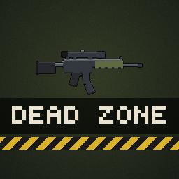

# DEAD ZONE - Downloads

Zombie apocalypse add-on for Minecraft Bedrock (phone, console and PC).

## Download

Get the latest `.mcaddon` from **[Releases](../../releases)**, then open it to import it into Minecraft.

## Part 1: Guns (v1.0.0 test build)

- 8 original guns: pistol, revolver, SMG, assault rifle, shotgun, sniper, LMG and rocket launcher
- Java-style animations: draw, recoil, sprint pose, aim down sights and realistic reloads
- Muzzle flash, shell casings, tracers, impact effects and original sounds
- Ammo for every gun, plus attachments: red dot, long scope, suppressor and extended magazine
- Field Manual with controls and tips

### Controls

| Action | Keyboard | Controller | Touch |
|---|---|---|---|
| Fire (hold for automatic) | Right-click | Left trigger | Use button |
| Aim down sights | Sneak | Sneak | Sneak |
| Reload | Left-click | Right trigger | Attack button |

Enable both DEAD ZONE packs on your world. In Creative mode ammo is unlimited.

Coming next: zombies, explosives, vehicles, aircraft and survival features.
